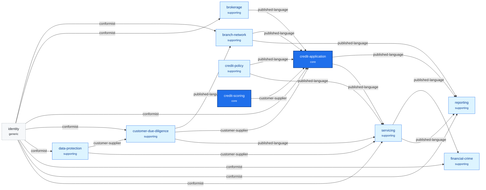

# Context map

The diagram and the table are generated by `npx ddd-ts-kit docs` from `ddd-ts-kit.config.json`
and the `CONTEXT.md` files. Everything outside the markers is written by the team and kept.

<!-- ddd-ts-kit:context-map -->

| Context | Classification | Purpose | Upstreams | Downstreams | Published events | Deployable alone |
|---|---|---|---|---|---|---|
| `branch-network` | supporting | Branches of a bank, its staff and their roles, the portfolio of each advisor, and the declared conflicts of interest. | `customer-due-diligence`, `identity` | `credit-application`, `reporting` | `branch-network.conflict-of-interest.declared`, `branch-network.staff-member.appointed` | no |
| `brokerage` | supporting | Brokers, their registration with the intermediaries register, and whether that registration is valid on a given day. | `identity` | `credit-application` | `brokerage.broker.registered`, `brokerage.broker.registration-lapsed` | no |
| `credit-application` | core | Takes an application from a customer or a broker to a decision, then to an offer the borrower accepts or withdraws. | `credit-policy`, `credit-scoring`, `customer-due-diligence`, `brokerage`, `branch-network`, `identity` | `servicing`, `reporting` | `credit-application.credit-application.decided`, `credit-application.credit-application.payout-authorised`, `credit-application.credit-application.reschedule-decided`, `credit-application.credit-application.submitted`, `credit-application.credit-application.withdrawn` | no |
| `credit-policy` | supporting | Holds the bank's reference data with dates of effect: products and their limits, rate grid, legal maximum rates, delegation table, residual income minimums and score thresholds. |  | `credit-application`, `servicing` | `credit-policy.delegation-table.published`, `credit-policy.legal-maximum-rate.published`, `credit-policy.product.defined`, `credit-policy.rate-grid.published`, `credit-policy.residual-income-minimum.published` | no |
| `credit-scoring` | core | Scores an applicant with the bank's versioned scoring model and says in words which factors pushed the score down. |  | `credit-application` |  | no |
| `customer-due-diligence` | supporting | Knows each customer: identity, business and its beneficial owners, screening, risk rating and refresh dates, kept as events. | `identity`, `data-protection` | `branch-network`, `credit-application`, `servicing` | `customer-due-diligence.customer.advisor-assigned`, `customer-due-diligence.customer.identified` | no |
| `data-protection` | supporting | Holds the retention schedule and the processing register, answers a customer's request for a copy of their data, and asks each context to erase after retention. | `identity` | `customer-due-diligence`, `servicing` |  | no |
| `financial-crime` | supporting | Watches repayments, raises alerts, and files suspicious activity reports with the financial intelligence unit. | `servicing`, `identity` |  |  | no |
| `identity` | generic | Who the people of the application are, the organisations they belong to and in which role. |  | `data-protection`, `brokerage`, `customer-due-diligence`, `branch-network`, `credit-application`, `servicing`, `financial-crime`, `reporting` | `identity.account.deactivated`, `identity.delegation.granted`, `identity.delegation.revoked`, `identity.member.joined`, `identity.member.removed`, `identity.member.role-changed`, `identity.organisation.opened` | no |
| `reporting` | supporting | Monthly figures per branch, portfolio at risk and the defaults list for the supervisor, exported as CSV. | `credit-application`, `servicing`, `branch-network`, `identity` |  |  | no |
| `servicing` | supporting | Runs the loan ledger from payout: the schedule, instalments and direct debits, early repayments, arrears buckets, the register declaration, default and handover to collections. | `credit-application`, `credit-policy`, `identity`, `data-protection`, `customer-due-diligence` | `financial-crime`, `reporting` |  | yes |
<!-- /ddd-ts-kit:context-map -->

## Reading guide

1. The main flow: due diligence, brokerage and branch management feed the application; the application's payout gate reads due diligence; a decision becomes a payout authorisation; servicing creates the loan and publishes its repayments.
2. Financial crime is a leaf: it reads servicing's facts and publishes nothing, and nothing publishes to it but servicing. Compliance's secret is structurally out of every other path.
3. Reporting is a leaf too: it reads events of four contexts and writes nothing back.

## Why these boundaries

- **credit-application and credit-policy**: a decision uses the delegation table and the rate grid and never edits them; their owners and their change dates differ, so one language each.
- **credit-application and credit-scoring**: the model is versioned on its own cycle, owned by model risk; the assessment only records the version, the inputs and the score it got.
- **credit-application and servicing**: before payout the object is an application, from payout a loan with a ledger; payout is the handover, published once.
- **customer-due-diligence and branch-network**: "customer" is a person the bank knows and must refresh, "portfolio" is which advisor follows which customer; two languages, two owners.
- **customer-due-diligence and credit-application**: the applicant applies, the customer is known to the bank; an applicant becomes a customer once identified.
- **servicing and financial-crime**: repayments are the facts watched; the alert and the report are another language with another visibility. Separating them makes the restriction hold by construction.
- **brokerage and credit-application**: a broker is an outside intermediary, not staff; the registration is checked on the day the application is brought.
- **reporting**: reads only, owns no rule; kept apart so that the reporting schedule never touches the ledger.
- **data-protection**: the retention schedule is one language; erasure is done by each context on its own data.
- **identity**: the kit's preset. Its "delegation" is the granting of access, not the credit delegation table.

## Relationship notes

- **credit-scoring to credit-application, customer-supplier**: the score is answered in the same call, so the assessment records one instant. Cost: scoring plans its contract to the application's needs.
- **customer-due-diligence to credit-application, customer-supplier**: "no credit is disbursed" must hold at payout, so the payout gate reads due diligence synchronously. Cost: payout waits if due diligence is down, which fails safe.
- **data-protection to customer-due-diligence and to servicing, customer-supplier**: the copy of data and the erasure after retention are planned into each context's work. Cost: the ledger keeps its amounts; only the personal data are destroyed.
- **identity to every context that acts on people, conformist**: the kit's preset is not ours to change, so the contexts use its ids as they are. Cost, accepted for the preset.
- The other arrows are published-language: each upstream publishes for many readers and the downstream keeps its own projection.

## Known tensions

- **Payout gate is synchronous, the rest eventual.** Signal to watch: a payout delayed by due diligence for more than a day.
- **Broker registration is a projection.** A broker whose registration lapses this morning may still bring an application until the event arrives. Accepted under the owner brief. Signal: an application brought after its registration lapsed, found by reporting; then make the check synchronous.
- **Credit-scoring is a separate context.** Its only consumer is the application and the answer comes in the same call. Signal to merge: a scoring change that always comes with an application change.
- **Erasure of event-sourced aggregates.** Erasure destroys the personal data of the events, not the events; the ledger's amounts stay. Signal: an examiner who needs a personal name from a loan older than ten years.
- **Financial crime has no outbound arrow.** Nothing tells servicing or the branch that a report exists; the cost is that servicing cannot react to a suspicious borrower, by design.
